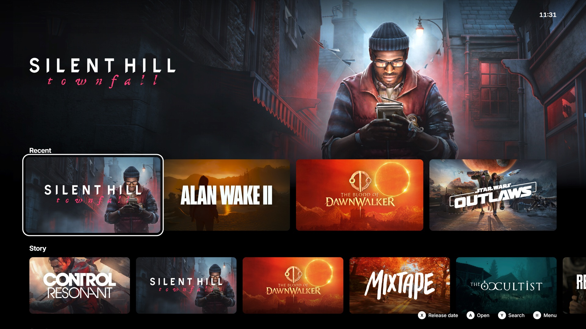
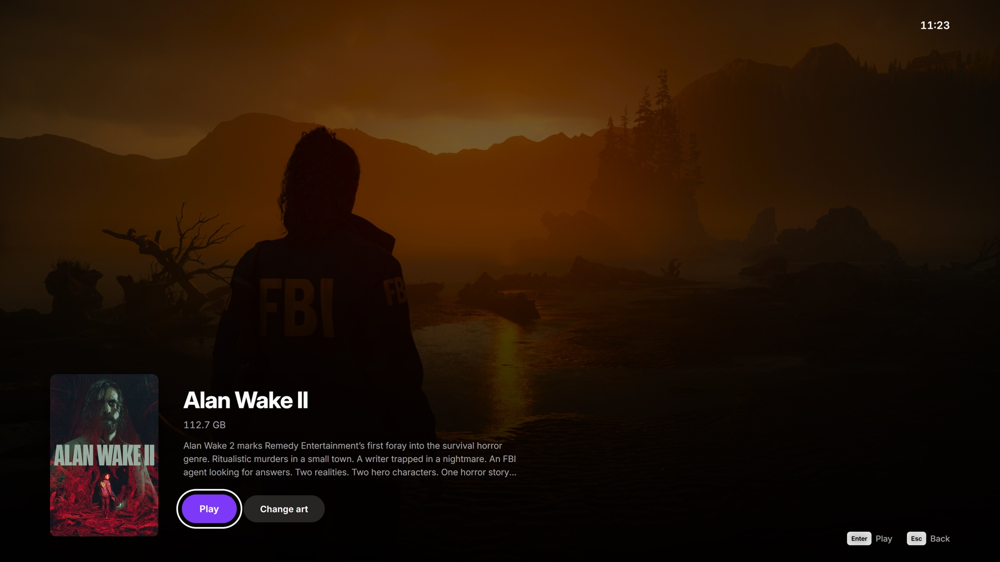
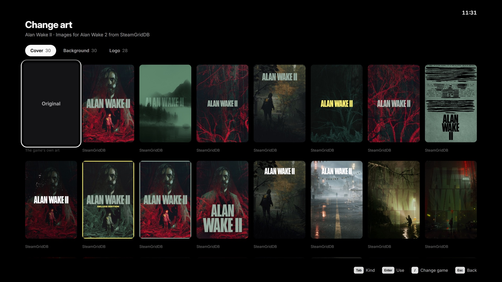
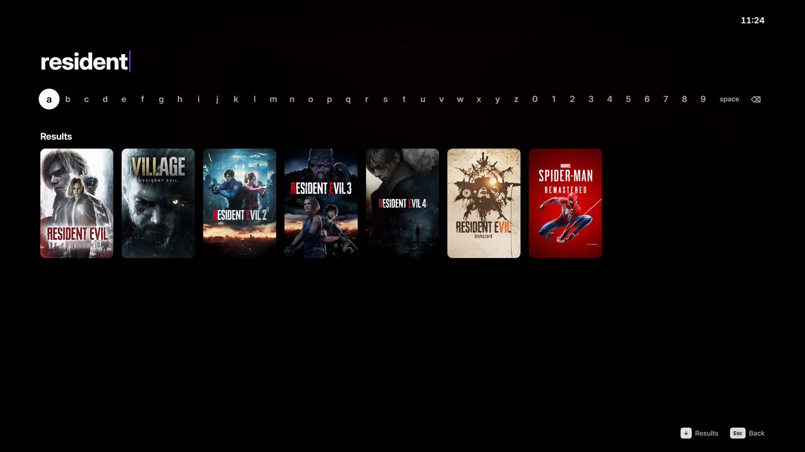
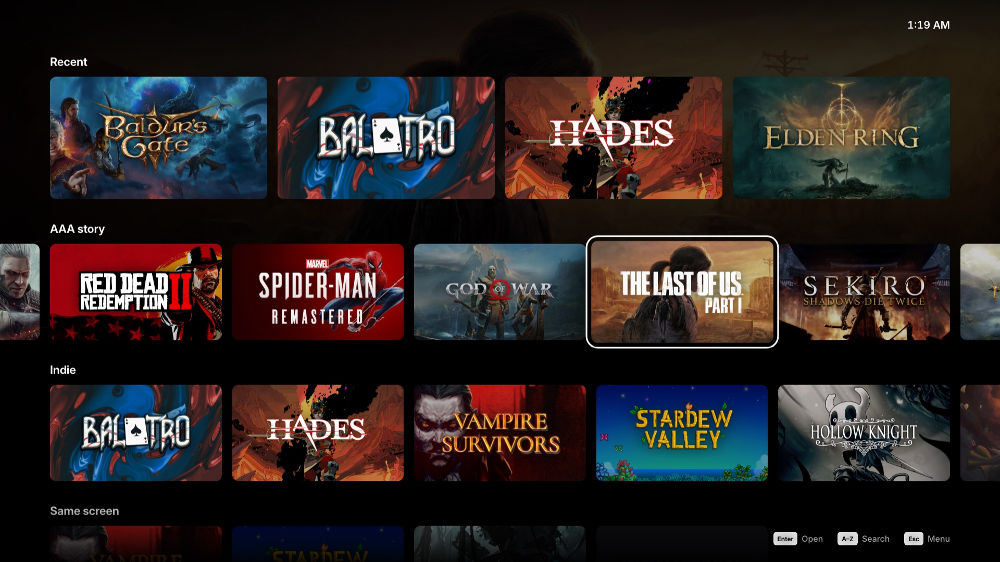
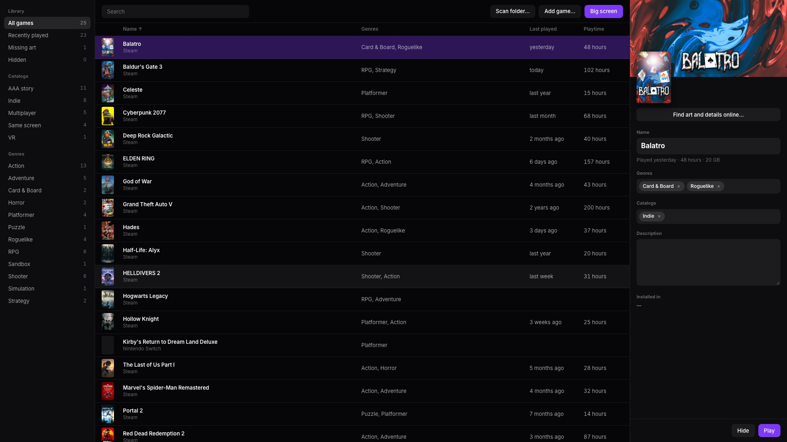

<p align="center"></p>

<h1 align="center">Beanbag Launcher</h1>

<p align="center">A calm, controller-first game launcher for the PC under your TV.<br>
Every game you own in one place. No store, no ads, no account.</p>



## What it does

- **Opens straight to your games.** Starts with Windows, full screen, and shows what you played last.
- **Rows that match how you play.** Story, Couch co-op (split screen and local co-op, for playing with someone on the couch), Online and Indie, then everything. Sort every row by recently played, A–Z, popularity or release date.
- **Every launcher, one library.** Finds your installed Steam, Epic and GOG games on its own. A one-time Playnite import brings in the rest: Battle.net, EA, Ubisoft, emulators and games you added by hand. After that, Playnite is not needed.
- **Fills in what is missing.** Covers, backgrounds, logos, descriptions and genres come from Steam and the LaunchBox Games Database, with no API keys.
- **Change any art, from the couch or the desk.** Open a game and choose Change art, or press Start on a game: a tab each for the cover, background and logo, with every image Steam, LaunchBox and SteamGridDB have for it. Pick one and it is in use at once. SteamGridDB needs your own free API key. A dark logo on dark art turns light, so it still reads.
- **Starts the game and steps aside.** Beanbag starts each game itself, gets out of the way while you play, records the playtime and comes back when the game closes.
- **Desktop mode for the desk.** A windowed library manager: add a game or scan a folder of games, edit names, rows and descriptions, change art, or find art and details online.
- **Search with a controller.** One row of letters, like Apple TV. Or start typing on a keyboard.

|  |  |
|---|---|
|  |  |



## Install

1. Download the latest `Beanbag Launcher_x.y.z_x64-setup.exe` from [Releases](../../releases).
2. Run it. Beanbag opens full screen and turns on **Start with Windows**.

Needs Windows 10 or 11 (x64). Beanbag uses Microsoft Edge WebView2, which Windows 11 already has.

### Bring in your Playnite library (optional)

Steam games show up on their own. To bring in everything else from Playnite, exit Playnite, then run:

```powershell
powershell -ExecutionPolicy Bypass -File scripts\import-playnite.ps1
```

It copies your games, their art, how each one starts and your playtime into Beanbag's folder. It never changes Playnite's own files, and it is safe to run again.

## Controls

| | Controller | Keyboard |
|---|---|---|
| Move | D-pad or left stick | Arrow keys |
| Open a game, then Play | A | Enter |
| Change art | X on an open game, or Start → Change art | Esc → Change art |
| Switch between cover, background and logo | LB / RB | Tab |
| Back | B | Esc |
| Search | Y | Type any letter, or `/` |
| Change the sort | X | Menu → Sort rows |
| Menu | Start (≡) | Esc on the home screen |
| Jump three rows | LB / RB | — |

The mouse works too: click a game to open it, and scroll with the wheel.

The menu opens with **Change art** for the game you are on, then **Desktop mode**, **Rescan library**, **Library layout** (rows or a grid), **Sort rows**, **Start with Windows** and **Quit to desktop**.

## Your data

Everything lives on your PC, in `%LOCALAPPDATA%\com.beanbag.launcher`:

| File | What it holds |
|---|---|
| `library.json` | Games brought in from Playnite |
| `user.json` | Games you added and anything you changed in desktop mode |
| `fixes.json` | Art and details found online |
| `stats.json` | When you last played each game, and for how long |
| `settings.json` | Your SteamGridDB API key, if you added one |
| `art/` | Covers, backgrounds and logos |

Beanbag has no account, no telemetry and no ads. It talks to the internet only to fill in missing art and details: the Steam store (search, art, tags, review counts) and the LaunchBox Games Database (a public download of about 100 MB, refreshed once a month). With your own key, it also asks SteamGridDB for covers, backgrounds and logos.

## Build from source

You need [Node.js](https://nodejs.org) 20+ and [Rust](https://rustup.rs). The Windows installer builds on Windows with the Visual Studio C++ build tools.

```bash
npm ci
npm run dev          # the interface in a browser, with sample games
npm run tauri dev    # the app, with your real library
npm run tauri build  # the Windows installer, in src-tauri/target/release/bundle/nsis
```

`./scripts/verify.sh` is the check every change must pass: types, unit tests, Rust tests, a production build, and a smoke test that drives every screen in a real browser.

### How it is built

- **Interface:** React and TypeScript, in `src/`. Big-screen mode is in `src/components`, desktop mode in `src/desktop`. Motion uses springs written as CSS `linear()` curves, and only animates transforms and opacity.
- **App:** [Tauri 2](https://tauri.app) and Rust, in `src-tauri/src`:
  - `library.rs` reads the library layers.
  - `steam.rs` and `vdf.rs` read Steam's own files; `launchers.rs` reads Epic's install manifests and GOG's registry entries.
  - `launch.rs` starts games and follows them by their install folder.
  - `art.rs` and `launchbox.rs` fill in missing art; `sgdb.rs` asks SteamGridDB, with your key.
  - `catalogs.rs` decides the rows.
  - `manage.rs` backs desktop mode.
- **Input:** the Gamepad API, read every frame, with key repeat that speeds up while you hold a direction.

## Contributing

Issues and pull requests are welcome. Please keep it calm: one job per screen, and nothing on screen without a reason. Run `./scripts/verify.sh` before you open a pull request. CI runs it on Windows for every push.

## Credits

Game details and art come from the Steam store, the [LaunchBox Games Database](https://gamesdb.launchbox-app.com) and, with your key, [SteamGridDB](https://www.steamgriddb.com). The Change art screen follows SteamGridDB's [plugin for the Steam Deck](https://github.com/SteamGridDB/decky-steamgriddb). Text is set in [Inter](https://rsms.me/inter/). Beanbag is not affiliated with Valve, Epic Games, GOG, LaunchBox, SteamGridDB or Playnite, and game art belongs to its publishers.

## License

[MIT](LICENSE)
